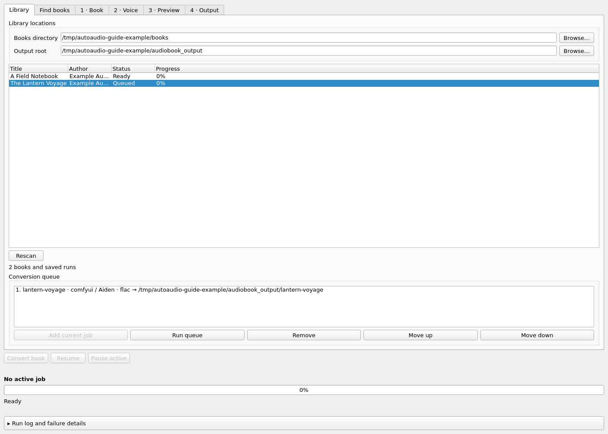
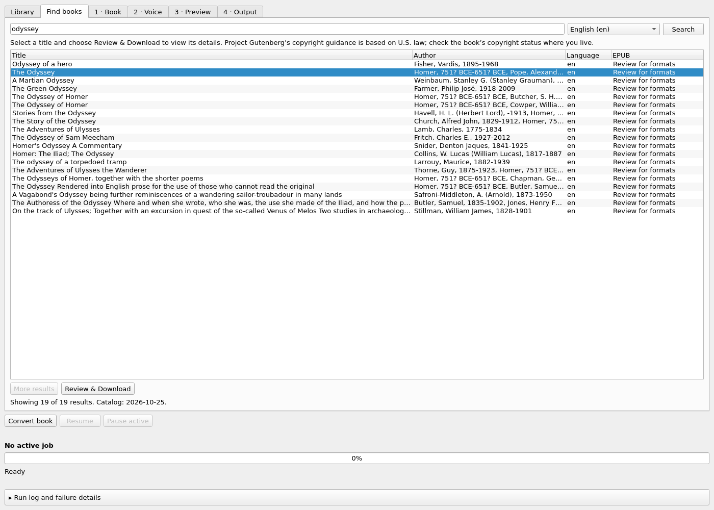
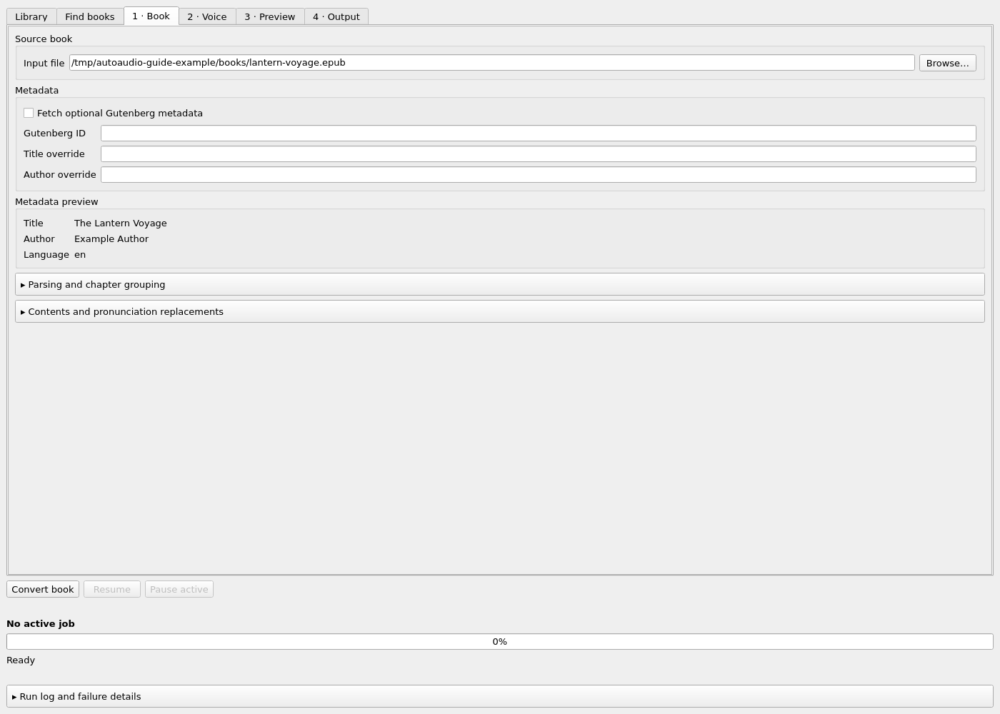
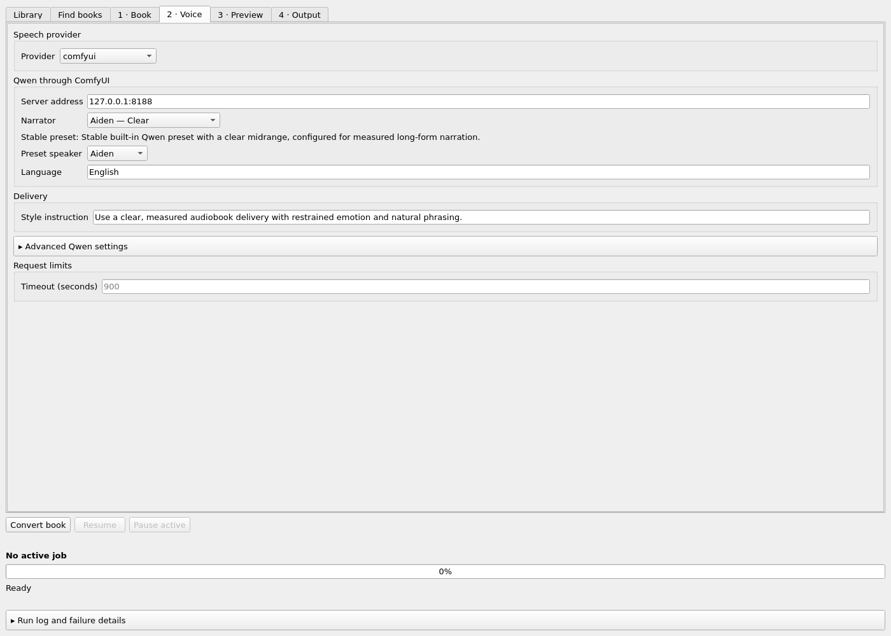
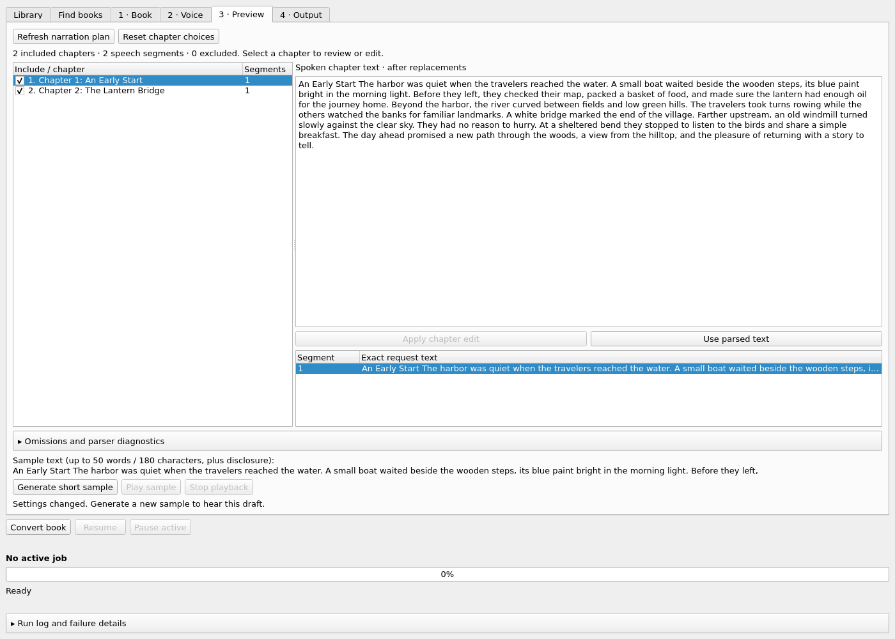
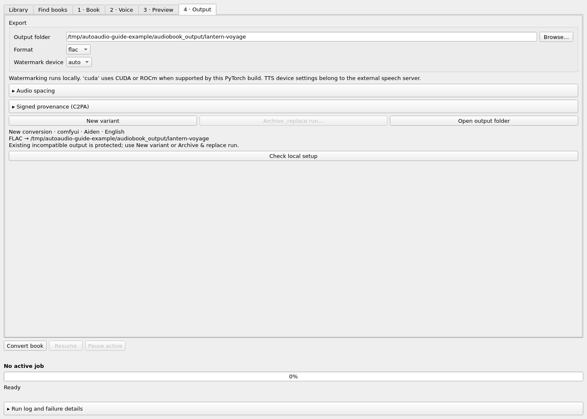

# GUI usage

After [installation and provider setup](installation.md), launch the desktop app:

```bash
autoaudio --gui
```

Follow **Book → Voice → Preview → Output** to review narration and create an audiobook.
The screenshots use an example book and generic local folders.

### Linux application launcher

To add AutoAudio to the application menu and associate its taskbar icon, run this in the Python
environment where AutoAudio is installed:

```bash
python -m gui.desktop
```

This installs a per-user desktop entry under `$XDG_DATA_HOME/applications` (normally
`~/.local/share/applications`), pointing to that environment's `autoaudio` command and packaged icon.
Launch **AutoAudio** from the application menu and pin it to the taskbar if desired. Rerun the command
if you move or replace the Python environment. Qt uses the same desktop-entry identifier for window
association; see [Qt's desktop-file guidance](https://doc.qt.io/qt-6/qguiapplication.html#desktopFileName-prop).

## Library and Find books

**Library** lists books in the configured source directory and saved runs. Select a book to work on its
draft or resume a previous run. You can change the source directory and output root, or browse to a
manual file on **Book**.



The queue captures the voice, format, and destination when a job is added. **Run queue** starts it.

**Find books** searches a saved Gutenberg catalog by title, author, subject, or book ID. The first search
downloads the catalog (roughly 6 MB); subsequent searches and **More results** work locally. Choose a
language from the filter after the catalog loads. The status line shows its date and any refresh problem.
Update checks occur during searches roughly weekly, and an existing catalog remains usable offline.

Select a result and choose **Review & Download** to fetch its current formats and rights, then confirm the
EPUB download. See [Library and book downloads](library-and-gutenberg.md) for cache locations, refresh
behavior, and copyright information.



## Book and voice

Select a source from **Library** or browse to a manual file on **Book**. Inspect its local metadata;
expand the parsing and pronunciation controls when you need to change chapter grouping or replacements.



On **Voice**, choose a provider, its endpoint, and a voice. Qwen profiles and built-in speakers are listed
for ComfyUI; HTTP providers use an existing voice ID. Advanced Qwen settings include seed, precision,
sampling, model size, and the TTS device on the external server. See [Narrators](narrators.md) and
[TTS providers](tts-providers.md).

New Qwen jobs default to **Aiden — Clear**, a native English voice. Saved drafts keep their selected
narrator; use **Restore saved run settings** when continuing an existing conversion.



## Preview and samples

**Preview** shows grouped chapters, inclusion choices, spoken chapter text after replacements, and the
individual speech requests. Review front matter and the expandable omission/parser diagnostics before
converting. Uncheck chapters to exclude them, or edit spoken text and press **Apply chapter edit**.
Edits apply after replacement rules, so editing a replaced word does not trigger another substitution.



Pending chapter edits block generation until applied or discarded with **Use parsed text**. Pending
editor text is saved in the draft. Chapter choices use one-based numbers from the grouped plan; after
changing grouping, use **Reset chapter choices** if the old numbers no longer apply. See
[Narration text preparation](narration-text.md) for CLI equivalents and parsing limits.

**Generate short sample** uses at most 50 whitespace words / 180 characters from the selected segment,
plus the fixed audible AI disclosure. It uses the normal provider and verified AudioSeal pipeline, with
FLAC output at `audiobook_output/.samples/<random-id>/audio/`. It does not convert the whole source.
The current text adapter omits excerpts of 20 characters or fewer, so select a longer segment for a sample.

For a longer public demo, see [Preparing a README narration sample](media/README.md).

**Play sample** plays the result using QtMultimedia, or opens it externally if that optional Qt module
is unavailable. Changing settings or the selected sample text invalidates playback for the current draft.

## Output and setup

Choose an output folder, format, and local watermark device on **Output**. Audio spacing and optional
C2PA signing settings are expandable. **Convert book** processes the included narration plan.



**Check local setup** reports ffmpeg/ffprobe availability and the installed PyTorch accelerator support.
It shows the effective watermark device request, including an environment override. The TTS device
belongs to the external speech server; watermarking runs locally. A setup check does not establish model
availability or successful GPU inference. Generate a sample to exercise the provider and full audio path.
See [CPU tuning](installation.md#audioseal-cpu-performance) for thread and detector-backend options.

The run panel retains the active job, progress/ETA, and speech, watermarking, assembly, encoding, and
signing timings while another draft is edited. The expandable log is searchable/copyable and opens on
failure. A pause request can wait for the current blocking HTTP-header read or ffmpeg operation to finish.

## Saved drafts, variants, and the queue

Drafts are stored atomically in `audiobook_output/.gui/drafts.json`. They preserve raw/incomplete field
values, rules, chapter choices/edits, pending editor text, manual sources, library locations, and selection
across rescans and app restarts. Private-key passwords and API key values are not persisted. An unreadable
draft file is preserved and reported. Recovery checkpoints remain separate and authoritative.

**New variant** copies the draft into a separate job with a fresh destination. **Archive & replace run…**
keeps the previous files at their original paths, records an archived library entry, and prepares a fresh
destination. The previous checkpoint paths remain usable; archiving does not move or delete audio.

Adding to the Library queue captures the settings at that time. Later draft edits do not modify queued
work. Review the voice/provider, format, destination, and order; remove/reorder jobs before **Run queue**.
**Queue conversion/resume** during an active job also authorizes subsequent dispatch. Pause or failure
stops advancement. Queues are session-only and do not start automatically at app launch. Changed/missing
queued sources and duplicate active/queued destinations are rejected before launch.

## Resume

**Saved plan for Resume** displays the frozen request text separately from the editable new-run plan,
including older segmentation. **Restore saved run settings** explicitly reloads checkpoint settings.
**Resume** checks source, settings, workflow, plan, and artifact compatibility before reusing work.
Use a new variant when changing an incompatible job; a completed job cannot be resumed.

The full compatibility rules and shared-server pause behavior are described in
[Resume, watermarking, and provenance](provenance-and-resume.md).
